<!-- ━━━━━━━━━━━━━━━━━━━━━━━━━━━━━━━━━━━━━━━━━━━━━━━━━━━━━━━━━━━━━━━━━━━━━━━━━━━ -->
<!-- RHODES ISLAND // PRTS TERMINAL — CODENAME: SUZURAN ("OUR LIGHT")            -->
<!-- ━━━━━━━━━━━━━━━━━━━━━━━━━━━━━━━━━━━━━━━━━━━━━━━━━━━━━━━━━━━━━━━━━━━━━━━━━━━ -->

<picture>
  <source media="(prefers-color-scheme: dark)" srcset="./assets/hero-dark.svg"/>
  
</picture>

 

&nbsp;
<a href="#operator-dossier"><code>01 · Dossier</code></a>
&nbsp;·&nbsp;
<a href="#arts-skills"><code>02 · Arts &amp; Skills</code></a>
&nbsp;·&nbsp;
<a href="#arsenal-loadout"><code>03 · Arsenal</code></a>
&nbsp;·&nbsp;
<a href="#battle-records"><code>04 · Telemetry</code></a>
&nbsp;·&nbsp;
<a href="#vitafield-archive"><code>05 · Archive</code></a>
&nbsp;·&nbsp;
<a href="#terminal-uplink"><code>06 · Uplink</code></a>

 

<!-- ━━━━━━━━━━━━━━━━━━━━━━━━━━━━━━━━━━━━━━━━━━━━━━━━━━━━━━━━━━━━━━━━━━━━━━━━━━━ -->

  <picture>
    <source media="(prefers-color-scheme: dark)" srcset="./assets/sec-01-dark.svg"/>
    
  </picture>
  <picture>
    <source media="(prefers-color-scheme: dark)" srcset="./assets/dossier-dark.svg"/>
    
  </picture>

 

<!-- ━━━━━━━━━━━━━━━━━━━━━━━━━━━━━━━━━━━━━━━━━━━━━━━━━━━━━━━━━━━━━━━━━━━━━━━━━━━ -->

  <picture>
    <source media="(prefers-color-scheme: dark)" srcset="./assets/sec-02-dark.svg"/>
    
  </picture>
  <picture>
    <source media="(prefers-color-scheme: dark)" srcset="./assets/skills-dark.svg"/>
    
  </picture>

 

<!-- ━━━━━━━━━━━━━━━━━━━━━━━━━━━━━━━━━━━━━━━━━━━━━━━━━━━━━━━━━━━━━━━━━━━━━━━━━━━ -->

  <picture>
    <source media="(prefers-color-scheme: dark)" srcset="./assets/sec-03-dark.svg"/>
    
  </picture>
  <picture>
    <source media="(prefers-color-scheme: dark)" srcset="./assets/arsenal-dark.svg"/>
    
  </picture>

 

<!-- ━━━━━━━━━━━━━━━━━━━━━━━━━━━━━━━━━━━━━━━━━━━━━━━━━━━━━━━━━━━━━━━━━━━━━━━━━━━ -->

  <picture>
    <source media="(prefers-color-scheme: dark)" srcset="./assets/sec-04-dark.svg"/>
    
  </picture>

  <b>FOXFIRE PATROL // CONTRIBUTION MATRIX</b> &nbsp;·&nbsp; <i>「数字は嘘をつかない」— Numbers don't lie</i>
    

  <picture>
    <source media="(prefers-color-scheme: dark)" srcset="./github-contribution-grid-snake-dark.svg"/>
    
  </picture>

    

  <picture>
    <source media="(prefers-color-scheme: dark)" srcset="https://github-profile-summary-cards.vercel.app/api/cards/profile-details?username=ImanNE1&theme=solarized_dark"/>
    
  </picture>
  &nbsp;
  <picture>
    <source media="(prefers-color-scheme: dark)" srcset="https://github-profile-summary-cards.vercel.app/api/cards/stats?username=ImanNE1&theme=solarized_dark"/>
    
  </picture>

    

  <picture>
    <source media="(prefers-color-scheme: dark)" srcset="https://github-profile-summary-cards.vercel.app/api/cards/repos-per-language?username=ImanNE1&theme=solarized_dark"/>
    
  </picture>
  &nbsp;
  <picture>
    <source media="(prefers-color-scheme: dark)" srcset="https://github-profile-summary-cards.vercel.app/api/cards/most-commit-language?username=ImanNE1&theme=solarized_dark"/>
    
  </picture>
  &nbsp;
  <picture>
    <source media="(prefers-color-scheme: dark)" srcset="https://github-profile-summary-cards.vercel.app/api/cards/productive-time?username=ImanNE1&theme=solarized_dark&utcOffset=7"/>
    
  </picture>

    

  <picture>
    <source media="(prefers-color-scheme: dark)" srcset="https://streak-stats.demolab.com/?user=ImanNE1&disable_animations=true&hide_border=false&border=1F4A56&background=073642&stroke=1F4A56&ring=4BC7CF&fire=F3C65F&currStreakLabel=F3C65F&sideLabels=CBD5E1&currStreakNum=FFF8E7&sideNums=4BC7CF&dates=93A1A1&border_radius=5"/>
    
  </picture>

 

<!-- ━━━━━━━━━━━━━━━━━━━━━━━━━━━━━━━━━━━━━━━━━━━━━━━━━━━━━━━━━━━━━━━━━━━━━━━━━━━ -->

  <picture>
    <source media="(prefers-color-scheme: dark)" srcset="./assets/sec-05-dark.svg"/>
    
  </picture>
  <picture>
    <source media="(prefers-color-scheme: dark)" srcset="./assets/archive-dark.svg"/>
    
  </picture>

 

<!-- ━━━━━━━━━━━━━━━━━━━━━━━━━━━━━━━━━━━━━━━━━━━━━━━━━━━━━━━━━━━━━━━━━━━━━━━━━━━ -->

  <picture>
    <source media="(prefers-color-scheme: dark)" srcset="./assets/sec-06-dark.svg"/>
    
  </picture>

   

  <a href="https://x.com/Neiko68438496">
    <picture>
      <source media="(prefers-color-scheme: dark)" srcset="./assets/btn-x-dark.svg"/>
      
    </picture>
  </a>
  &nbsp;
  <a href="https://www.linkedin.com/in/immanuel-kp-66936a289/">
    <picture>
      <source media="(prefers-color-scheme: dark)" srcset="./assets/btn-linkedin-dark.svg"/>
      
    </picture>
  </a>
  &nbsp;
  <a href="https://www.instagram.com/immanuelkristiandika/">
    <picture>
      <source media="(prefers-color-scheme: dark)" srcset="./assets/btn-instagram-dark.svg"/>
      
    </picture>
  </a>
  &nbsp;
  <a href="https://stackoverflow.com/users/24802952/immanuel-kristiandika-putra">
    <picture>
      <source media="(prefers-color-scheme: dark)" srcset="./assets/btn-stackoverflow-dark.svg"/>
      
    </picture>
  </a>

 

<!-- ━━━━━━━━━━━━━━━━━━━━━━━━━━━━━━━━━━━━━━━━━━━━━━━━━━━━━━━━━━━━━━━━━━━━━━━━━━━ -->

  <picture>
    <source media="(prefers-color-scheme: dark)" srcset="./assets/footer-dark.svg"/>
    
  </picture>

